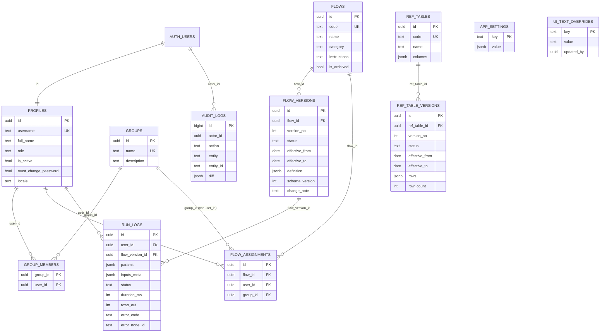
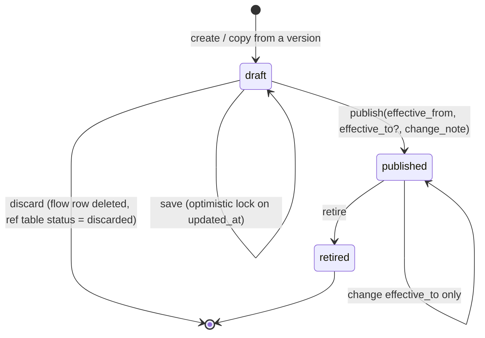

# 03 — Domain and Data Model

> This document is the **specification of the model**. It was recorded from the previous
> implementation (`supabase/migrations/*.sql`, `packages/flow-schema/src/*.ts`, `apps/web/src/engine/`
> at commit `6fd5868`). The rewrite builds the schema again from it, in a new Supabase project
> (ADR-012). Behaviour must not change.
> Node-level behaviour (each node's config and semantics, the 41 formula functions, validation
> messages) stays in the frozen reference `docs/archive/spec.md` §8–§14, §24, §27, §34.

## 1. Domain glossary

| Term | Meaning |
|------|---------|
| Flow | A named data process identified by `code`; has versions |
| Flow version | One immutable (once published) definition of a flow, valid for an effective date range |
| Flow definition | JSON DAG: `params`, `inputSlots`, `nodes`, `edges` (`packages/flow-schema/src/flow.ts`) |
| Input slot | Declares one kind of uploaded file: sheet, header row, columns (aliases, type, rules), multi-file |
| Node | One step; type `group.name` (e.g. `transform.join`); implemented by an engine plugin |
| Run | One execution of a flow version on local files; leaves a metadata-only run log |
| As-of date | The date used to choose the flow version (and later reference-table versions) |
| Reference table | Admin-maintained lookup data without personal data, versioned by effective date |
| Assignment | Grants a user or a group the right to run a flow |

## 2. Entities (server)



### Field constraints (as implemented)

| Table | Field | Type / rule |
|-------|-------|-------------|
| profiles | `username` | `^[a-z0-9][a-z0-9._-]{1,30}[a-z0-9]$`, unique |
| profiles | `full_name` | ≤ 120 chars |
| profiles | `role` | `admin` \| `user` |
| profiles | `locale` | `vi` \| `en` |
| groups | `name` | 1–80 chars (trimmed), unique |
| flows | `code` | `^[a-z0-9][a-z0-9-]{1,62}[a-z0-9]$`, unique |
| flows | `name` / `description` / `category` / `instructions` | ≤ 160 / 1000 / 80 / 2000 chars |
| flow_versions | `status` | `draft` \| `published` \| `retired` |
| flow_versions | `definition` | JSON object, ≤ 1 MiB (`pg_column_size`) |
| flow_versions | `effective_to` | null or `> effective_from` |
| flow_versions | uniqueness | `(flow_id, version_no)`; one draft per flow; published ranges of one flow never overlap (`daterange(from, to, '[)')` exclusion) |
| flow_assignments | target | exactly one of `user_id`, `group_id` |
| run_logs | `params` | flat scalar map, ≤ 20 keys |
| run_logs | `inputs_meta` | array ≤ 50 of `{ slot, rows, files: [{ sha256, size }] }`, ≤ 200 files per slot, no other keys |
| run_logs | `status` | `succeeded` \| `failed` \| `cancelled` |
| run_logs | `error_code` | i18n key `^[A-Za-z][A-Za-z0-9_.]{0,99}$` — never raw text |
| audit_logs | `action`, `entity` | `^[a-z_.]{1,64}$`, `^[a-z_]{1,64}$` |
| ref_tables | `code` | `^[A-Z][A-Z0-9_]{1,63}$`, unique |
| ref_tables | `columns` | JSON validated by `private.ref_columns_valid` (key, title, type, file header, key flag) |
| ref_table_versions | `status` | `draft` \| `published` \| `retired` \| `discarded` |
| ref_table_versions | `rows` | JSON array ≤ 50,000 rows and ≤ 5 MiB |
| ui_text_overrides | `key` | `<namespace>:<i18n key>`, ≤ 200 chars |
| ui_text_overrides | `value` | null (= default) or ≤ 2000 chars, non-blank, no `<tag` |

## 3. Entities (client only, never stored on the server)

| Entity | Lives in | Notes |
|--------|----------|-------|
| Uploaded file bytes, parsed tables | Worker memory | Released on new run / tab close |
| Validation report, result tables, KPIs | Worker memory + React state | Shown on screen, downloadable |
| Designer sample files | Worker memory | Preview only |
| Auth session tokens | `sessionStorage` key `hrflow.auth` | Only item in browser storage |

Flow definition shape (`FlowDefinitionSchema`): `schemaVersion: 1`, `params[]` (`key`, `label`,
`type` ∈ string|number|date|month|boolean|select, `required`, `log?`, `isAsOfDate?`, `options?`),
`inputSlots[]`, `nodes[]` (`id`, `type`, `label?`, `config`), `edges[]` (`from`, `fromPort?`, `to`,
`toPort?`), `ui?`. Invariants: unique node ids, edges reference existing nodes, unique slot keys,
acyclic graph.

Schemas live in `packages/flow-schema/src/` (T-R1-02): `identifier.ts`, `params.ts`, `slots.ts`,
`nodes.ts` (input / control / output nodes), `transforms.ts` (§12.1.1–§12.1.8, §12.2), `flow.ts`,
`migrate.ts`. Every object is strict (an unknown field is an error). Each invariant failure has its
own issue path: `nodes.<i>.id`, `edges.<i>.from|to`, `inputSlots.<i>.key`, `edges` (cycle).

Defaults and limits the spec does not write (learned from the previous implementation
`6fd5868:packages/flow-schema/src/`, confirmed D-03-3; spec defaults are not repeated here):

| Where | Field | Default / rule |
|-------|-------|----------------|
| Identifier | column, slot, param, port, node id | `^[a-z_][a-z0-9_]*$` |
| Node | `type` · `config` | `^[a-z]+\.[a-zA-Z]+$` · `{}` |
| Flow | `params`, `inputSlots`, `edges` · `nodes` | `[]` · at least 1 |
| Flow `ui` | `positions` · `notes` | `{}` · `[]` |
| Param | `required` · `log` unset | `false` · logged by type: free-text `string` not logged, other types logged |
| Slot | `required` · `accept` · `sheet` | `true` · `.xlsx` (the only format, MEMORY 2026-11-16 09:26) · `{ mode: 'byIndex', value: 0 }` (0-based) |
| Slot | `headerRow` · `headerRows` · `dataStartRow` | `1` (1-based) · `1`, max 5 · `headerRow + headerRows`, never inside the header |
| Slot | `unmergeCells` · `multiple` · `maxRows` | `'none'` (or `'fillDown'`) · `{ enabled: false, minFiles: 1, maxFiles: 50 }`, `minFiles <= maxFiles` · optional, warning above it |
| Slot | `skipRows` | `{ whenBlank: key[] (≥ 1, slot columns), whenKeyContains: [] }`: a row whose `whenBlank` columns are all blank, or contain one of the texts (normalised), is skipped, not an error |
| Slot column | `required` · `presence` unset · `rules` · `decimalSeparator` | `false` · follows `required` (`true` → `'required'`) · `[]` · `'.'` (or `','`) for numbers stored as text |
| Slot column | `key` · keys · `defaultValue` | must not start with `_` · unique in the slot · fits the type (`date` `YYYY-MM-DD`, `datetime` `YYYY-MM-DDTHH:mm:ss`), not with `required: true` |
| Slot column | rule `severity` · `dateFormats` | `'error'` · `excelSerial` or tokens `yyyy MM M dd d HH mm ss` with separators |
| `control.compare` | `tolerance` · `carryColumns` · `sideLabels` | `'0'`, ≥ 0 · `[]` · optional `{ left, right }` (unset = i18n "A" / "B"); metric labels unique |
| `output.excel` | `fileName` · sheet `name` | `'output.xlsx'` · 1–31 chars, none of `: \ / ? * [ ]`, no apostrophe at either end, unique without case |
| `transform.formula` | `title` · column `key` | trimmed, 1–200 chars · unique in the node |
| `code.sql` | `inputs[].port` | unique |


## 4. Business rules and calculations

### 4.1 Version lifecycle



- Published versions are immutable except `effective_to` and the transition to `retired`.
- Rollback = publish a new version whose content is copied from an old one.
- `version_no` = max(existing) + 1 within the flow; a discarded flow draft frees its number.

### 4.2 Effective-date resolution

A published version **applies** on date `d` when
`effective_from <= d AND (effective_to IS NULL OR effective_to > d)` — the range is half-open
`[effective_from, effective_to)`.

`d` = value of the parameter flagged `isAsOfDate` (a `month` parameter means its **first day**,
e.g. `2026-09` → `2026-09-01`; logic in `shared/versioning/as-of.ts`), or today (browser local
date) when the flow has no such parameter or it is not filled in.

Worked example — flow `payroll-timesheet`:

| Version | effective_from | effective_to | Applies on 2026-03-31 | on 2026-04-01 | on 2026-09-15 |
|---------|----------------|--------------|-----------------------|---------------|---------------|
| v1 | 2026-01-01 | 2026-04-01 | yes | no | no |
| v2 | 2026-04-01 | null | no | yes | yes |

Publishing v3 from 2026-07-01 while v2 is open-ended is rejected for overlap unless the publish
call asks to close the previous version, which sets v2 `effective_to = 2026-07-01`.

### 4.3 Compare (`control.compare`)

For each metric with `left`, `right`, `tolerance` (decimal, default 0):

```
diff      = right − left          (decimal arithmetic, never float)
mismatch  = |diff| > tolerance    (|diff| == tolerance is a match)
blank     = 0 when nullAsZero is true (default); the cell is still shown blank in the output
```

Keys are matched after normalisation (4.4). A key present on one side only goes to
`only_left` / `only_right`.

Worked example (tolerance 0.5 for work days, 0 for overtime):

| Key | Work days L | Work days R | diff | OT L | OT R | diff | Result |
|-----|-------------|-------------|------|------|------|------|--------|
| NV001 | 22 | 22.5 | 0.5 | 4 | 4 | 0 | match (0.5 is not > 0.5) |
| NV002 | 22 | 21 | −1 | (blank) | 0 | 0 | mismatch on work days |
| nv003␠ | 20 | — | — | — | — | — | joins `NV003` after normalisation |

Output rules (`apps/web/src/engine/nodes/control-compare.ts`, T-R1-05; learned from `6fd5868`, owner confirmed D-03-6, MEMORY 2026-11-16 12:52):

| Area | Rule |
|------|------|
| `mismatched` columns | Keys `<col>__left`, `__right`, `__diff`; base `<left>_<right>` when the two columns differ; a taken key gets the 1-based metric index (`cong_2__left`); plus `_mismatched_metrics` = failing metric labels joined with ", " |
| `summary` | Columns metric, tolerance, matched, mismatched, only_left, only_right, total_diff; one row per metric plus a total row (`compare.summary.totalRow`, blank tolerance and total_diff); matched = keys with no failing metric; total_diff = sum of every diff with both values, within tolerance included |
| Values | Every metric output column is `decimal`; key columns take the left value; carry columns the left value, the right one when the left is blank or missing (same type only); `only_left` / `only_right` keep the input schema |
| Order | `mismatched` and `only_left` in left order, `only_right` in right order |
| `duplicateKey` | Trimmed original values, joined with " \| " for composite keys (on-screen only, 4.7) |
| `output.excel` file name | `{param}` → parameter value (month `YYYY-MM`, date `YYYY-MM-DD`, formatted by the caller); unknown placeholder → empty; `\ / : * ? " < > \|` and control characters → `_`; empty → `output`; `.xlsx` added when missing |

### 4.4 Key normalisation

`normalizeKeyPart(v)` = NFC → collapse whitespace runs to one space → trim → lowercase.
Used by `control.compare`, the slot rule `unique`, and (default on, Admin can switch off)
`transform.join`, `transform.dedupe`, `transform.filter`. The same semantics exist in SQL
(`hrflow_norm_key`); a change on one side must change the other and its equivalence test.

### 4.5 Numbers, dates, text

| Rule | Detail |
|------|--------|
| Decimal | Money and day counts use `big.js` in TS and `DECIMAL(38,10)` in DuckDB; decimals cross to the UI as strings |
| Rounding | `ROUND` is half away from zero (Excel behaviour) |
| Blank metric cell | Treated as 0 in arithmetic, `""` in concatenation; a formula that is only a column reference returns blank for a blank cell |
| Text column | Takes the text Excel displays (keeps `00123`); Excel's locale short date (`m/d/yy`) is shown as `dd/mm/yyyy` (MEMORY 2026-11-16 08:52, 2A) |
| Date column | Always accepts a real Excel date cell regardless of the configured text format |
| Ambiguous numeric text (`"1,500"`) | Warning |
| Result file name | `month` parameter → `YYYY-MM`; `date` parameter → `YYYY-MM-DD` |
| Sort | Vietnamese collation (`Intl.Collator('vi')`); `min`/`max` on text use binary order |

### 4.6 Input validation (file check before a run)

| Case | Outcome |
|------|---------|
| Missing required column / missing key column | 1 error ("missing column"), no per-row errors |
| Two columns matching the same required column | error |
| Header present, no data rows | warning |
| Duplicate key within a slot (after normalisation), also across files of the slot | error on every file involved |
| Row whose key cell holds a configured skip text (e.g. "TỔNG CỘNG") | skipped |
| `.csv`, `.xls` | not accepted: `validation.fileTypeNotAccepted`; only `.xlsx` (MEMORY 2026-11-16 09:26, owner 1B) |
| Not a ZIP package (an OLE2 `.xls` renamed `.xlsx` included) | `validation.fileUnreadable`; SheetJS never reads a file (it only formats numbers, `SSF`) |
| Stored flow listing `.csv` / `.xls` in `accept` | `migrateFlowDefinition` removes them with a notice (`accept{Csv,Xls}Removed`, the last of an emptied slot `…OnlyReplaced`); an emptied slot gets `.xlsx` |
| Decompression | `fflate` `Inflate` only (streamed, bytes counted, early stop), never `DecompressionStream` (MEMORY 2026-11-16 08:52, 3A) |
| Archive limits | 2 GiB per entry; ratio 1:200 for entries > 16 MiB; per-file budget |

Reader rules (`apps/web/src/engine/io/`, T-R1-04; learned from `6fd5868` or chosen in T-R1-04, owner confirmed D-03-5):

| Area | Rule |
|------|------|
| Zip limits | Declared sizes of every entry are checked when the archive opens; the per-file budget counts every read of every entry; more data than declared (declared 0 included, stored or deflated) → `fileTooLarge` |
| Unreadable | Shared-string index out of range; a cell beyond row 1,048,576 or column XFD; ZIP64, encryption, multi-disk, unknown method, duplicate names, truncation, bad CRC |
| SheetJS parity | Only the first `<t>` of a plain `<si>`; phonetic runs (`<rPh>`) left out; `<row/>` ignored; `t="str"` unescaped twice; empty `t="b"` = FALSE; unknown `t` = text; unknown error text = blank; `t="d"` ISO → serial; Excel 1900 leap-year bug kept; General numbers show 15 significant digits; a cell before the first row is skipped |
| Merges | Header cells follow merges; a text repeated by a vertical merge is kept once; overlapping ranges resolved per column (the last range starting at or before the row wins) |
| Headers, keys | Normalised: diacritics removed, đ → d, lowercase, single spaces. Missing key column = a `skipRows.whenBlank` column with `presence: 'required'`; skip rules apply only when every key column is found. Sheet `byName`: exact name, then normalised name |
| Values | Default `dateFormats`: `dd/MM/yyyy`, `yyyy-MM-dd`, `excelSerial`. Boolean words: `co` / `dung` / `x` … true, `khong` / `sai` … false. Thousands groups have 3 digits; ambiguous = 1–3 digits, a separator, 3 digits |
| Columns | `extraColumns: 'keep'` uses slug keys, `_2` … on a clash; a missing optional column reads blank; `_source_file` title = its key; `unique` messages keep the original values |
| Report | No cap on the number of issues; a file's error count includes duplicates where it is the related file |

### 4.7 Run log content (data minimisation)

Stored: user id, flow version id, parameters flagged for logging, per slot `{ slot key, row count,
files: [{ sha256 of file NAME, byte size }] }`, status, duration, rows out, error **key**, error
node id, flat client info. Never stored: file names, cell values, raw error text.

One exception in on-screen messages (never in `run_logs`): `compare.error.duplicateKey` shows the duplicated key value (`{{key}}`), as the owner text says (MEMORY 2026-11-16 12:41, 3B).

### 4.8 Reference tables

- Columns are defined at table level; every version uses the current column set.
- Each version ≤ 50,000 rows and ≤ 5 MiB; draft edited in the grid or replaced by an Excel import (read in the worker).
- Import warns when a column name looks like personal data; the Admin must confirm "not personal data"; the confirmation is audited.
- Same lifecycle and effective-date rule as flows (4.1, 4.2).

### 4.9 Engine core (`apps/web/src/engine/core/`, T-R1-03, owner confirmed D-03-4)

| Area | Rule |
|------|------|
| Planner errors | Keys `executor.error.*` of the owner-edited locale (`docs/archive/locales-vi/engine.json`): bad config → `invalidConfig {node, path}`; `duplicateNode`, `unknownNode`, `unknownPort`, `portConnectedTwice`, `missingPort`, `cycle`. An edge without a port is valid only when the node has exactly one port on that side, else `ambiguousPort`. A plugin with neither `execute` nor `compile` = `unknownNodeType`. |
| Order | Topological; ties follow the order of `flow.nodes`. A cycle is reported at a node on the cycle. |
| Error params | `node` = the node label, or its id without a label; edge errors use the id. Never a cell value (4.7). |
| Executor | Events `node-started` / `node-finished` (rows per output port, `durationMs`). An unexpected exception of a plugin → `executor.error.nodeFailed`, without its raw message. A table is released right after its last reader; on error every table is released, results included. |
| Perf | User Timing measures `hrflow:<stage>`, stage ∈ `read` · `upload` · `sql` · `write` · `run`; names only, no data. |
| Decimal | `decimalFromNumber` = 15 significant digits; a decimal column is a `Float64Array` plus a row → exact-text map for values a double cannot hold (spec §9.4); big.js division keeps its default of 20 decimal places before the half-up rounding to 10. |
| Plugin contract | `checkConfig` returns an array of `EngineError` (it does not throw). DuckDB side (T-R1-07, D-03-8): `compile(config, inputs: {ref, columns}, ctx & {sql: SqlDialect})` → `{ports: {sql, params, columns, finish?}, warnings?}` (count queries); `runsInSql?(config, inputSchemas)` when a plugin has both `execute` and `compile` (sort runs in TS when it orders by a `string` column). `ExecuteContext` adds `warn?`, `emitPreview?`; the run result adds `warnings[]`, `previews[]` (`{nodeId, title, table, totalRows, truncated}`). |
| DuckDB access (T-R1-07) | `core` and `nodes` import no DuckDB code: the executor gets an `SqlRuntime` through `ExecuteOptions.sql?: () => Promise<SqlRuntime>` (implemented by `engine/duckdb/scope.ts` `loadSqlScope`), opened at most once and only when a node runs in DuckDB |
| Pushdown (D-03-8) | Chains of CTEs (not views, so prepared parameters work); materialise with `CREATE TABLE hr_tab_<n> AS …` only before a TS node, for a run result, or when a port feeds several nodes; an unread port is a result (materialised, e.g. dedupe `removed`); a port with `finish` (groupBy `avg`) materialises at its node; rows of a lazy port are counted where it materialises; aliases `"hr$…"`, avg hidden columns `_avg_sum_<i>` / `_avg_count_<i>`. A failure while materialising is located by probing the chain step by step (count only, on failure only) and reported at the first failing node (MEMORY 2026-11-16 13:34, 1A) |
| Transform details (D-03-8) | groupBy: blank text = NULL, group order = first appearance, `sum` of all blanks = 0, integer `sum` cast to BIGINT (beyond int64 → `decimalOverflow`). join: blank / normalised-empty keys become NULL (never match); order left, then right-only rows; `right` / `full` key = left value else right, integer with decimal → decimal; the `rowsMultiplied` count query re-runs the input chains. filter: a `string` column takes text or a number, not a boolean; decimals rounded half-up to 10 places; dates `YYYY-MM-DD`, datetimes `YYYY-MM-DDTHH:mm:ss`; `contains` / `startsWith` / `endsWith` normalise the value too; without a run context a parameter counts as empty. sort: `Intl.Collator('vi', {sensitivity: 'accent'})`. union: source column last, title = its key; `typeMismatch` has no field path. preview: a column listed twice shows once. dedupe: a partly blank key equals blank. |
| Run context (MEMORY 2026-11-16 12:41, 1A) | `ExecuteContext` has an optional `run?: { slots, params, emitFile }`, passed through by `executor.ts` for every node; a node that needs it and gets none fails with `executor.error.noRunContext` |
| Run context content (D-03-6) | `run.slots` holds the `SlotReadResult` (table + report) of the pre-run check per slot key, so files are read once; the executor releases those tables, so one `slots` object serves one run. `run.params` values are `string \| number \| boolean \| null`. `emitFile({fileName, mimeType, bytes})`. `input.excel` `checkConfig` reports `executor.error.unknownSlot`. |
| Plugin hook `warnings?` (D-03-6) | Optional `warnings?(config, flow): NodeWarning[]` for design-time warnings such as `inputExcel.warning.extraColumnsRuntimeOnly` (spec §12.1.9); called by the Designer (P6) |
| DuckDB runtime (T-R1-06, D-03-7) | Parts `duckdb/<version>-<sha12>/duckdb-eh.wasm.partN` (20 MiB), manifest also embedded in the worker build and served by the dev server; Cache Storage `hrflow-duckdb-<version>-<sha256>` (older ones with that prefix removed); instantiation timeout 120 s → `duckdb.error.loadFailed`; `DEFAULT_RUNTIME` (no file system, no network) in browser and Node; settings applied and locked before the macros are created; uploads in chunks of 122,880 rows; Arrow data built with `makeData` (Arrow builders use `new Function`) |
| DuckDB types (D-03-7) | Decimals rounded half-up and checked on the way in; on the way out only checked for more than 28 integer digits. Small integer types and `UBIGINT` → `integer`, or `decimal` when beyond the safe range; an integer column with any unsafe value becomes `decimal` as a whole; `HUGEINT` / `UHUGEINT` → `decimal`; `ENUM`, `TIME`, `JSON` and every other type not in spec §9.4 → `sql.error.unsupportedType`. Overflow recognised by the DuckDB message ("Out of Range" / "overflow"); DuckDB's own text never enters an `EngineError` |
| Hidden row order (MEMORY 2026-11-16 13:11, 2A) | The hidden order column of spec §12.1 (`__ord`) is named `hr$ord` (`ORD_COLUMN` / `ORD_SQL` in `engine/duckdb/sql.ts`): `IdentifierSchema` never accepts `$`, so no user column can clash; a user column `__ord` is an ordinary column |
| Texts (MEMORY 2026-11-16 12:41, 2A) | Output titles (e.g. compare columns, summary rows) come from an optional translator `t(key, vars)` in the design / execute context, built from the owner-edited locale; the engine holds no UI text; without `t` the key is used |

## 5. Validation rules by layer

| Layer | Validates | Mechanism |
|-------|-----------|-----------|
| Schema package | Flow definition, slot, node config shape | Zod (`packages/flow-schema`) |
| Engine planner | Cross-node rules (slot exists, columns exist, types) | `checkConfig`, `inferSchema` → `EngineError` with i18n key |
| Designer | Same checks live, labelled by form field | `engine/design.ts` via worker → `issue-text.ts` |
| Database | Sizes, formats, ranges, lifecycle, ownership | CHECK constraints, exclusion constraints, guard triggers, RPC |
| Edge Function | Request body | Zod |
| UI forms | Required / format before submit | `FormField` error slot; never the only check |

## 6. Access control matrix (RLS, as implemented)

| Table | `user` (active) | `admin` | `anon` |
|-------|-----------------|---------|--------|
| profiles | read own; update own `full_name`, `locale` | read all; writes through Edge Function | — |
| groups, group_members | read own memberships | all | — |
| flows | read flows assigned (directly or by group) that have a published version | all | — |
| flow_versions | read **published** versions of accessible flows | all (guard trigger still applies) | — |
| flow_assignments | read own | all | — |
| run_logs | read own; insert own for a runnable version | read all | — |
| audit_logs | — | read | — |
| app_settings | read | all | grant only; RLS returns no rows (keep-alive ping) |
| ui_text_overrides | read | read, insert, update | read `key`, `value` of edited rows |
| ref_tables, ref_table_versions | — (planned: read published versions used by assigned flows) | read, insert, update via RPC | — |

Service role is used only inside the Edge Function `admin-users`.

## 7. Audit logging

| Event | Recorded by | Content |
|-------|-------------|---------|
| Row changes on `groups`, `group_members`, `flows`, `flow_versions`, `flow_assignments`, `app_settings`, `ref_tables`, `ui_text_overrides` | Trigger `audit` → `private.audit_row` | actor, action, entity, id, config diff |
| Account create / reset / lock / role change | Edge Function | actor, target id, changed fields (no password) |
| Reference table version changes, "not personal data" confirmation | `private.audit_ref_version`, `private.audit_ref_no_personal_data` | actor, table, column names confirmed |
| UI text change | Trigger `private.set_ui_text_author` | author + time on the row (plus the generic audit row above) |
| Flow run | Client insert into `run_logs` | see 4.7 |

There is no compensation or personal HR data on the server, so there is nothing of that kind to
audit server-side. If decision 2A is ever reversed, this section must be redesigned first.

## 8. Migration strategy

The schema is created from scratch in a new Supabase project (ADR-012). The first migrations
implement §2–§7 of this document and are applied with the tool that records migration history, so
the history is correct from the first file. No row of the previous project is carried over unless
the owner asks (`06-plan.md` §2 question 7).

Rules for every migration (procedure in the `db-migration` skill):

1. New file `supabase/migrations/<UTC timestamp>_<name>.sql`; never edit an applied file.
2. Additive first (new nullable column / new table), backfill, then switch code, then constrain. Removal is a separate later migration after one release.
3. New table: `revoke all … from public, anon, authenticated`, then explicit grants, `enable row level security`, policies, SQL test file in `supabase/tests/` wrapped in `begin … rollback`.
4. Run the SQL tests on the real DB (`db-tests.yml`) and the security advisor before merging to `main`.
5. Take a backup run (`backup.yml`, includes restore verification) before any migration that rewrites data.

## 9. Compliance flags (information only — not legal advice)

The owner decided on 2026-11-12 that this is a personal experiment and company IT / legal review is
skipped. If the tool is ever used with real colleagues' data in a company context, these points
need a qualified review against Vietnam's personal data protection rules (Decree 13/2023/NĐ-CP and
the Personal Data Protection Law in force from 2026 — verify the current text):

| # | Point | Where it arises |
|---|-------|-----------------|
| C-1 | Account data (`username`, `full_name`) and activity logs are personal data of the tool's users | `profiles`, `run_logs`, `audit_logs` |
| C-2 | That data is stored outside Vietnam (Supabase region Singapore) — cross-border transfer | Hosting |
| C-3 | HR files are processed on the user's device; the organisation still decides purpose and means of that processing | Whole product |
| C-4 | Reference tables rely on an Admin's declaration that they hold no personal data | `ref_table_versions.rows` |
| C-5 | Retention: `app_settings.run_log_retention_months` = 12 and `purge_run_logs()` exist; whether the purge is ever invoked is **UNVERIFIED**; `audit_logs` has no retention rule | `app_settings`, RPC |
| C-6 | Backups contain account and log data, encrypted with a passphrase held by the owner | `backup.yml` artifacts (90 days) |

## 10. Decisions, assumptions, open questions

| ID | Type | Statement |
|----|------|-----------|
| D-03-1 | DECISION | The new schema reproduces this model in a new Supabase project (ADR-012); behaviour reference stays in `docs/archive/spec.md`. |
| D-03-2 | DECISION | Version lifecycle SQL stays duplicated for flows and reference tables (ADR-007). |
| A-03-1 | ASSUMPTION | This document is complete enough to rebuild the schema; a gap found while writing the migrations is settled with the owner (`06-plan.md` Q-06-2). |
| D-03-3 | DECISION (MEMORY 2026-11-16 07:55, 1A) | The §3 defaults the spec does not write (T-R1-02) repeat the previous implementation (read in git, written here); confirmed by the owner. |
| D-03-4 | DECISION (MEMORY 2026-11-16 08:13, 3A) | Engine core rules of 4.9: learned from the previous implementation or chosen in T-R1-03; confirmed by the owner. |
| D-03-5 | DECISION (MEMORY 2026-11-16 09:26, 2A) | The reader rules of 4.6: learned from the previous implementation or chosen in T-R1-04; confirmed by the owner. |
| D-03-6 | DECISION (MEMORY 2026-11-16 12:52, 1A) | Compare / output rules of 4.3 and the run-context and `warnings?` rows of 4.9: learned from the previous implementation or chosen in T-R1-05; confirmed by the owner. |
| D-03-7 | DECISION (MEMORY 2026-11-16 13:11, 3A) | DuckDB runtime and type rows of 4.9: learned from the previous implementation or chosen in T-R1-06; confirmed by the owner. The DuckDB side of the plugin contract (`compile`, executor) is left to T-R1-07. |
| D-03-8 | DECISION (MEMORY 2026-11-16 13:34, 1A 2A) | Plugin-contract DuckDB side, pushdown and transform rows of 4.9: learned from the previous implementation or chosen in T-R1-07; confirmed by the owner; failures in a chain reported at the failing node. |
| Q-03-1 | OPEN QUESTION | Who calls `purge_run_logs()` and how long `audit_logs` are kept (C-5) is not decided. Default until decided: nothing is purged automatically. |
